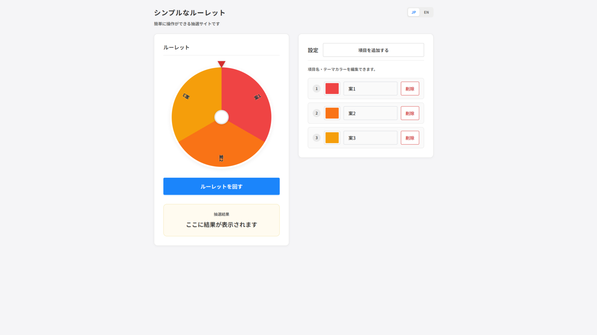

# シンプルなルーレット

項目を入力して使うシンプルなルーレットです。

https://simpleroulette.net/



## 機能

- 項目の追加・編集・削除
- 項目ごとの色変更
- 日本語・英語表示
- スマートフォン対応

## 開発環境

- React 18
- Vite 5
- Node.js 18 以上

## 起動方法

```bash
npm install
npm run dev
```

通常は `http://localhost:5173` で開きます。

## ビルド

```bash
npm run build
npm run preview
```

ビルド結果は `dist` に出力されます。
